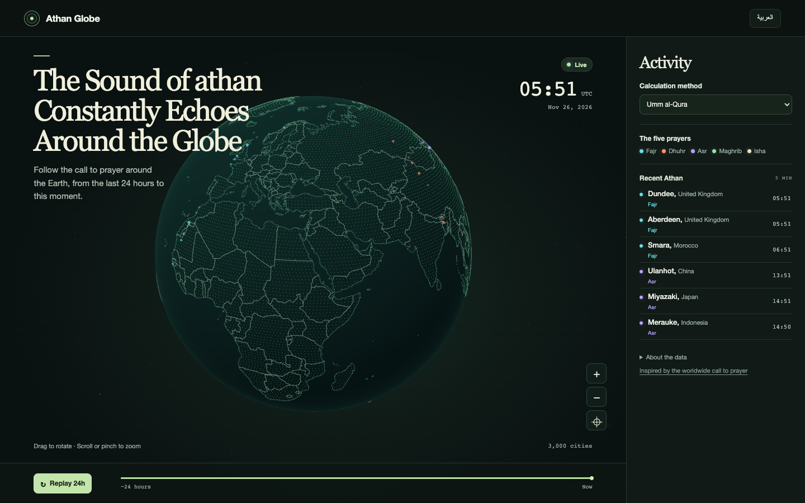

# الأذان حول العالم

[English](README.md) | **العربية**

[استكشف الكرة الأرضية مباشرة](https://hamzakat.github.io/athan-realtime-globe/)

استُلهم هذا المشروع من مقال [«The Sound of Azaan Constantly Echoes Around the Globe»](https://albalagh.net/general/the-sound-of-azaan-constantly-echoes-around-the-globe). يُجسّد فكرة انتقال الأذان حول العالم مع حلول أوقات الصلاة في أماكن مختلفة. تعرض كرة أرضية تفاعلية هذا الإيقاع المشترك وتدعو الزائر إلى تتبّعه واستكشاف المدن على امتداده.



شاهد بداية أوقات الصلاة المحسوبة خلال الساعات الأربع والعشرين الماضية، ثم اترك الكرة مفتوحة لمتابعة أوقات الأذان المباشرة. اسحب لتدوير الكرة، أو استخدم عجلة الفأرة أو إصبعين للتكبير، واختر مدينة لعرض وقتها المحلي. تُطبّق طريقة الحساب المختارة على العالم كله، والطريقة الافتراضية هي أم القرى.

## التشغيل محليًا

```sh
nvm install
nvm use
npm ci
npm run dev
```

افتح الرابط المحلي الذي يعرضه Vite. لمعاينة نسخة الإنتاج والتحقق منها، شغّل الأوامر التالية:

```sh
npm test
npm run coverage:seasons
npm run build
npx playwright install chromium
npm run test:e2e
npm run preview
```

تُنشئ عملية البناء جداول لخمسة أيام بالتوقيت العالمي المنسق لكل طريقة حساب مدعومة. يُعيد مسار GitHub Actions إنشاء البيانات يوميًا وينشر نسخة ثابتة متكاملة. في مستودع GitHub، اختر **GitHub Actions** مصدرًا للنشر من **Settings → Pages**. يعمل المسار من الفرع `main` ويدعم النشر ضمن مسار فرعي للمشروع.

## البيانات

- تحسب مكتبة [Adhan JS](https://github.com/batoulapps/adhan-js) أوقات بدء الصلاة. قد تتبع بعض المدن جداول محلية مختلفة. تضيف طريقة أم القرى 30 دقيقة إلى وقت العشاء في أمسيات رمضان وفق تقويم أم القرى المحسوب. بالقرب من القطبين، يمكن للمولّد استخدام أقرب خط عرض تتوفر فيه الأحداث الشمسية المطلوبة.
- يوفّر [GeoNames](https://www.geonames.org/export/) قائمة المدن بموجب رخصة CC BY. يعطي اختيار المدن الأولوية للعواصم والتغطية الجغرافية، ويستبعد أحياء المدن والأماكن المهجورة والتاريخية. تستخدم أسماء المدن الصيغة الواردة في GeoNames.
- يوفّر [Natural Earth](https://github.com/nvkelso/natural-earth-vector/tree/v5.1.2) طبقات اليابسة والسواحل وحدود الدول بمقياس 1:50 مليون ضمن الملك العام. تتبع طبقة الحدود حدود السيطرة الفعلية.

يتضمن التطبيق طبقات الخرائط المعالَجة. لإعادة إنشائها من ملفات المصدر، مرّر مجلدًا يحتوي على الملفات التالية إلى الأمر `npm run geography -- /path/to/source-files`. يتحقق البرنامج من بصمات SHA-256 المضمّنة. ينشر GeoNames نسخة متغيرة من البيانات، لذا احتفظ بالملف المضغوط المؤرخ لإعادة إنشاء النسخة نفسها.

| اسم الملف | المصدر |
| --- | --- |
| `cities5000.zip` | [نسخة GeoNames cities5000](https://download.geonames.org/export/dump/cities5000.zip)، استُرجعت في 2026-11-26 |
| `land.json` | [يابسة Natural Earth في الإصدار v5.1.2](https://raw.githubusercontent.com/nvkelso/natural-earth-vector/v5.1.2/geojson/ne_50m_land.geojson) |
| `coastline.json` | [سواحل Natural Earth في الإصدار v5.1.2](https://raw.githubusercontent.com/nvkelso/natural-earth-vector/v5.1.2/geojson/ne_50m_coastline.geojson) |
| `borders.json` | [الحدود البرية الدولية من Natural Earth في الإصدار v5.1.2](https://raw.githubusercontent.com/nvkelso/natural-earth-vector/v5.1.2/geojson/ne_50m_admin_0_boundary_lines_land.geojson) |
